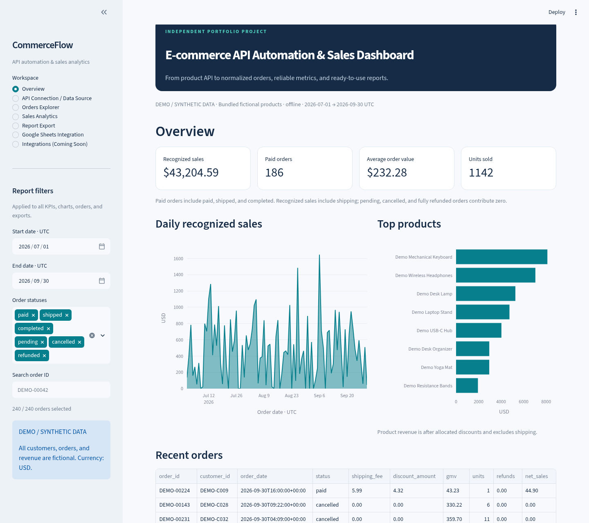

# E-commerce API & Operations Automation

> **🚀 [Open the Live Streamlit Demo](https://ecommerce-api-automation.streamlit.app/)**
>
> Explore the sales dashboard in your browser. No Google login required. All customers, orders, and revenue are synthetic.

CommerceFlow — E-commerce API Automation & Sales Dashboard.

A working Python portfolio application that connects a public product API to normalized commerce data, reproducible sales analytics, and downloadable business reports. Built for demonstrating REST integration, data validation, monetary arithmetic, reporting, and Streamlit UI development.

**Independent portfolio project. DEMO / SYNTHETIC DATA. No real client engagement, customer records, transactions, or actual revenue.**

- GitHub repository: https://github.com/minghong777/ecommerce-api-automation

## Preview



[Verified Google Sheets API read-back](docs/portfolio/screenshots/06-google-sheets-verification.png) · [Demo walkthrough](docs/DEMO.md)

## Real API versus synthetic data

[DummyJSON products](https://dummyjson.com/docs/products) supplies public sample product metadata only. The client requests `id,title,category,price` with `limit`/`skip` pagination; descriptions, reviewers, emails, images, and other unnecessary fields are not retained. The API does **not** supply dashboard orders or revenue.

The bundled `assets/products.json` is a small, explicitly fictional, authored catalog, not a live API snapshot. Offline mode is the default and performs no network requests. Customers are named `Demo Customer 001`, etc.; no emails or real identities are generated.

A fixed seed (`20261022`) produces 240 synthetic orders, 40 fictional customers, and purchase-time line items dated July–September 2026 UTC. The same seed and catalog reproduce the same dataset. Switching catalogs regenerates orders and can change revenue; this is clearly shown in the source page. A live catalog is capped at 500 records.

## Features

- **Overview:** source disclosure, four KPIs, daily trend, top products, recent orders.
- **API Connection / Data Source:** explicit fetch, product preview, record count, actual UTC retrieval time, errors, offline switch.
- **Orders Explorer:** shared ID search/date/status filters, normalized orders and purchase-time line-item details.
- **Sales Analytics:** revenue trend, status breakdown, product performance, financial reconciliation.
- **Report Export:** in-memory CSV, JSON, and styled Excel workbook with Summary, Orders, OrderItems, TopProducts sheets.
- **Google Sheets Integration:** credential status and filtered dry-run preview, with trusted CLI synchronization. The legacy Integrations route explains how to activate external scheduling; no jobs run until you configure them.

The public web entrypoint refuses a credentialed environment; keep Google service-account keys exclusively in a separate private CLI process. The public app needs no Google Secrets or spreadsheet destination.

The sidebar date range (inclusive UTC dates), status selection, and case-insensitive order-ID substring search apply to all KPIs, charts, tables, and exports. Selecting no statuses gives an empty result, not an implicit “all.” The API catalog preview is intentionally independent of order filters.

## Tech stack

Python 3.11+ (3.12 tested), Streamlit >=1.66.1, httpx, pandas, Plotly, openpyxl, pytest. The dashboard and CLI dry-run need no API keys, paid services, or credentials. Optional Google Sheets writes use `google-auth` service-account authentication configured outside the repository. Optional Playwright is used for browser verification only.

## Local setup

```bash
git clone https://github.com/minghong777/ecommerce-api-automation.git
cd ecommerce-api-automation
python3.12 -m venv .venv
source .venv/bin/activate
python -m pip install -r requirements.txt
streamlit run app.py
```

Use any available Python 3.11+ executable in place of `python3.12`. The default URL is `http://localhost:8501`. If port 8501 is occupied:

```bash
.venv/bin/python -m streamlit run app.py --server.port 8502
```

Alternatively, with `uv`:

```bash
uv venv --python 3.12 .venv
uv pip install --python .venv/bin/python -r requirements.txt
.venv/bin/python -m streamlit run app.py
```

Start offline; use **API Connection / Data Source → Fetch products from DummyJSON** to opt into network access. Failed fetches leave the active dataset unchanged. Successful fetches are cached for 15 minutes with their original retrieval timestamp.

## Architecture

```text
app.py                 Dashboard workspaces, integration preview, shared filters
src/config.py          Limits, endpoint, statuses, seed
src/models.py          Immutable normalized entities, validation, money conversion
src/transform.py       External payload validation and field minimization
src/api_client.py      Bounded HTTP requests, retry/backoff, pagination, provenance
src/demo_data.py       Bundled catalog and deterministic synthetic generator
src/metrics.py         Filtering, order totals, KPIs, trends, product allocations
src/reports.py         In-memory safe CSV/JSON/Excel reports
src/automation.py      Independent CLI for previews, exports, and scheduled sync
src/sheets.py          Official Sheets v4 REST client and atomic owned-tab snapshots
src/sheets_auth.py     Protected service-account loading and token refresh
examples/              Inactive cron and GitHub Actions scheduling templates
assets/products.json   Offline fictional catalog
scripts/browser_check.py Optional browser verification and screenshots
tests/test_core.py     Unit, HTTP mock, export, and Streamlit tests
```

### Normalized schema

| Entity | Fields |
|---|---|
| Products | product_id, title, category, unit_price |
| Customers | customer_id, display_name |
| Orders | order_id, customer_id, order_date, status, shipping_fee, discount_amount |
| OrderItems | order_id, product_id, quantity, unit_price_at_purchase |

**All internal money fields are integer USD cents**, including names such as `unit_price`. API prices are converted with `Decimal` and `ROUND_HALF_UP`. IDs are unique; order/customer/product foreign keys must exist. Order-product pairs are unique, quantities are positive integers, timestamps are timezone-aware, and each order must have items. Discounts cannot exceed merchandise totals. Unit prices are bounded at USD 1,000,000.

## Metric definitions

Let merchandise subtotal be `sum(quantity × unit_price_at_purchase)` for an order. Let full charge be `subtotal − discount_amount + shipping_fee`.

| Metric | Definition |
|---|---|
| Selected GMV | Merchandise subtotal for **all selected orders**, including pending/cancelled/refunded; shipping and discounts excluded |
| Paid GMV | Subtotals for statuses `paid`, `shipped`, `completed` |
| Discounts | Discounts for those three recognized statuses |
| Shipping fees | Shipping for those three recognized statuses |
| Recognized sales / net sales | Paid GMV − paid discounts + paid shipping |
| Paid order count | Number of selected paid/shipped/completed orders |
| AOV | Recognized sales ÷ paid order count, half-up rounded to a cent; zero when no paid orders |
| Units sold | Quantities on paid/shipped/completed orders |
| Refunds | Full charge of orders currently marked `refunded`, including shipping |
| Cancelled orders / cancelled GMV | Count / merchandise value of selected cancelled orders; zero recognized sales |
| Daily sales | Recognized sales by original UTC order date; missing days shown as zero |
| Top product revenue | Recognized merchandise revenue after allocated discounts; excludes shipping |
| Status distribution | Count by current status among selected orders |

**Refund policy:** only full refunds are modeled. Refunded orders have zero current recognized revenue and units sold; the original charge is separately disclosed as refunds and is not subtracted again. Pending and cancelled orders have zero recognized sales. `paid`, `shipped`, and `completed` are mutually exclusive current statuses, not separate payments. AOV includes shipping. Taxes and payment-processing fees are not modeled. These are demo operational metrics, not an accounting ledger.

Purchase-time prices are preserved independently of the product catalog. For product-level discounts, integer division and a largest-remainder allocation distribute each order discount exactly; ties use ascending product ID. Product revenue plus recognized shipping therefore equals net sales without rounding drift. Dollar floats are used only for UI display and chart plotting; calculations use cents.

## Exports and safety

- CSV: filtered normalized orders, UTF-8 BOM, stable column headers even for empty selections.
- JSON: disclosure, source, UTC generation time, exact filter metadata, summary, orders, order items, and product performance.
- Excel: Summary, Orders, OrderItems, TopProducts; styled headings and frozen rows.
- Monetary export values are **exact decimal strings in USD**, avoiding binary floating-point changes. Convert text deliberately if doing spreadsheet calculations.
- CSV/Excel formula-like strings (`=`, `+`, `-`, `@`, including leading whitespace) are prefixed with an apostrophe; invalid XML controls are removed. JSON preserves text and is not executed.
- Files are generated in memory, capped at 10 MB, and not stored by the application. Browser-check downloads are fictional test artifacts in ignored `artifacts/`.
- API uses HTTPS, explicit timeouts, at most 3 attempts per page with 0.25/0.5-second backoff for transport failures and HTTP 408/429/500/502/503/504. Other HTTP errors fail immediately.
- Responses are streamed and capped at 2 MB per page. Pagination checks totals, offsets, duplicates, and progress. Dataset limits: 500 products, 5,000 orders, 25,000 items.
- No arbitrary execution, credentials, customer PII, or external tracking is introduced. Only the public product dataset is shared through cache; there is no private upload feature.

## Tests

```bash
.venv/bin/python -m pytest -q
```

Tests cover deterministic generation, offline fixtures, referential integrity, integer currency and rounding, refund/cancellation policies, filters, reconciliation, exact exports, empty exports, formula injection, mocked API retries/errors/pagination, and Streamlit workspaces. Phase 3 adds mocked Google Sheets/authentication tests and standalone CLI verification.

Optional real-browser verification (with app running on port 8502 and Google Chrome installed):

```bash
uv pip install --python .venv/bin/python playwright
.venv/bin/python scripts/browser_check.py
```

This checks desktop navigation, actual downloads, filtered JSON export, and a 390-pixel mobile viewport. Outputs and screenshots are placed in ignored `artifacts/`.

## Demo limitations

Synthetic data cannot establish actual business performance. Refunds have no separate refund timestamps, so this demo is a current-status view grouped by original order date, not period cash flow. There are no partial refunds, tax, FX, inventory updates, real checkout, persistent storage, logins, or an installed background scheduler. Google Sheets writes require your own authorization. Real writes and full read-back verification were completed on a dedicated test spreadsheet on 2026-10-23; credentials and destination identifiers are excluded from this repository. Catalog changes on the public service may change generated results. Network latency can trigger bounded retries; offline mode remains fully usable. The source is published on GitHub, and the public demo is available through the Live Streamlit Demo link above.

## Phase 3: Google Sheets and scheduled automation

Implemented: standalone CLI, configurable dedicated worksheets, service-account
credentials, idempotent atomic report snapshots, credential-free dry-run, protected
public integration preview, and inactive cron / GitHub Actions examples.

```bash
.venv/bin/python -m src.automation --help
.venv/bin/python -m src.automation --dry-run
.venv/bin/python -m src.automation --export-dir artifacts/automation
```

**Before real synchronization, read [Phase 3 setup and synchronization strategy](docs/PHASE3.md).**
That guide covers Google authorization, protected credentials, exact command
examples, data replacement semantics, retry/unknown-outcome behavior, scheduling,
exit codes, and hosting limitations. Dry-run performs no Google requests and is
not proof of remote access. Real Google writes have been verified separately; no scheduler has been activated. Existing unmanaged worksheet data is always refused.

## Verified delivery

On 2026-10-23, two real Google Sheets synchronizations and complete API read-back
checks succeeded. These are historical results, not a live connection indicator. Both snapshots contained 19 summary data rows, 240 orders with
240 unique IDs, and 12 product-sales rows. All cells matched the expected offline
report. Recognized synthetic sales reconciled to USD 43,204.59; zero duplicate
orders appeared after the second run. The existing unrelated worksheet was retained.

- [Sanitized real API evidence](docs/portfolio/sheets-verification.json)
- [Full validation history](VALIDATION.md)
- [Reproducible demo walkthrough](docs/DEMO.md)
- [Upwork title, role, description, skills, and captions](PORTFOLIO.md)
- [Portfolio screenshots](docs/portfolio/screenshots/)
- [Publication preparation](docs/DEPLOYMENT.md)

Read all actual managed target values back without writing:

```bash
.venv/bin/python scripts/verify_sheets.py --evidence artifacts/readback.json
```

This command requires your securely configured environment. It fails if any cell,
row count, order ID, or financial reconciliation differs from the expected offline
report. The generated evidence excludes spreadsheet IDs and account credentials.
Historical evidence is dated; it does not assert permanent or current access.

The owner authorized publication of the final-review updates on 2026-10-25.
The GitHub repository contains the reviewed source, documentation, and images.
The owner-provided public Streamlit URL was verified on 2026-10-26. Further cloud
configuration changes and scheduler activation require separate approval; no scheduling is enabled.


## Final public-demo review

See [deployment preparation](docs/DEPLOYMENT.md) for the exact repository, `main`
branch, `app.py` entrypoint, Python 3.12 setting, and the requirement to leave Cloud
Secrets empty. The current Streamlit minimum is the locally tested 1.66.1; older
1.45 releases do not support the layout arguments used here. Root requirements
were installed in a fresh environment during review. App fixtures and modules
resolve from the source directory, not a developer-specific absolute path.

The browser checker accepts `--url` for a trusted test server and exercises all
seven workspaces on desktop and 390-pixel mobile layouts, including real downloads.
The Sheets screenshot is explicitly labelled historical. The public demo is
https://ecommerce-api-automation.streamlit.app/; never substitute a private
spreadsheet URL for the public demo link.
